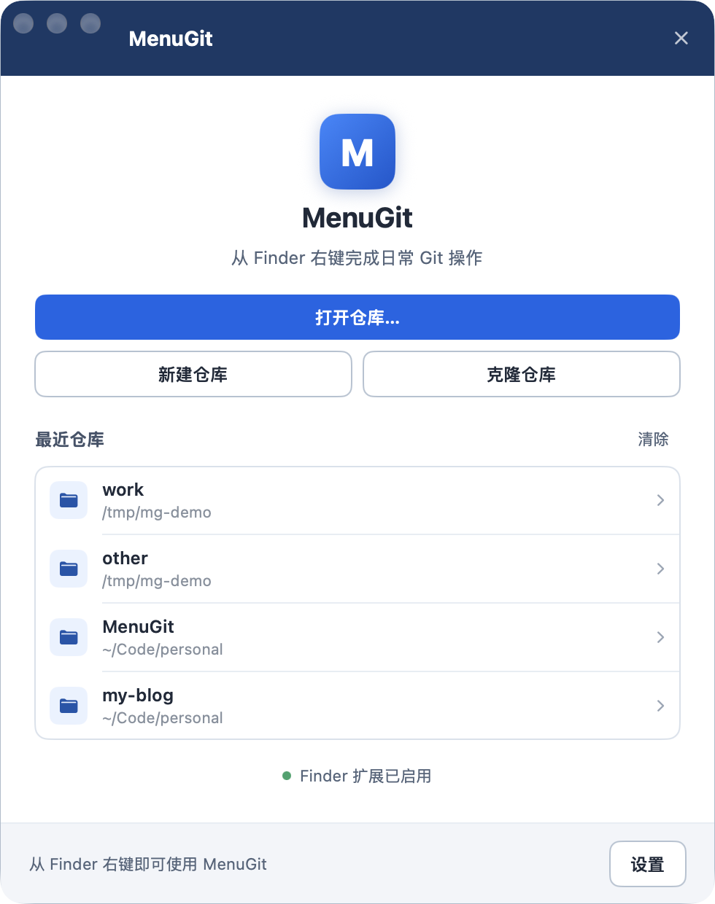
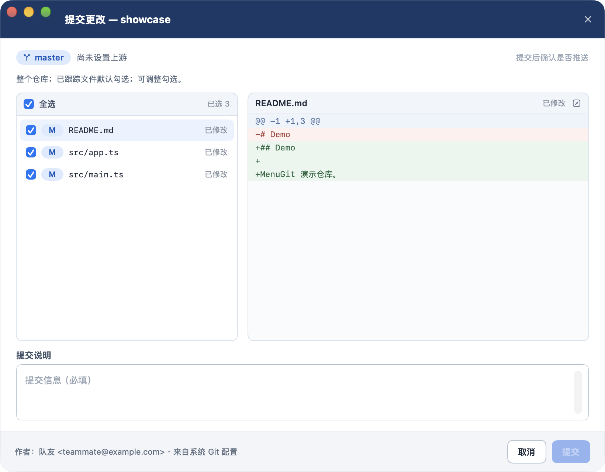
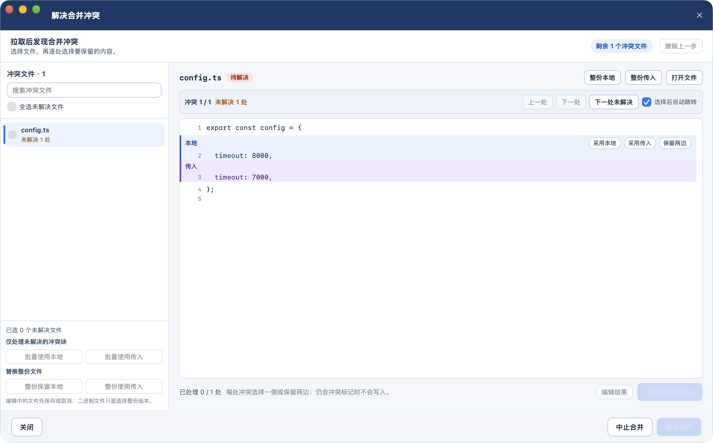

# MenuGit


macOS 上的 Git 右键菜单工具 —— 类似 TortoiseGit 的简化版。

在 Finder 里右键仓库中的文件、文件夹或空白处，就能直接完成提交、推送、拉取、分支和日志操作；遇到合并冲突时用可视化的冲突块选择代替命令行。所有操作都调用系统 Git，沿用你现有的 SSH key、credential helper、hooks 和 Git 配置。



## 功能

| 功能 | 说明 |
| --- | --- |
| Finder 右键入口 | 仓库内文件、文件夹、空白处右键；多选文件进入提交或日志上下文；非仓库目录提供创建和克隆 |
| 提交 | 查看文件状态与逐文件差异，勾选要提交的文件，填写提交说明；只创建本地提交 |
| 推送 | 预览待推送提交、选择远端与分支、首次推送自动设置上游；提交后弹独立的推送确认，推送成功后只显示完成页 |
| 拉取 | 选择远端分支拉取，沿用你在 Git 中配置的 pull 策略 |
| 分支 | 查看本地与远程分支，创建并切换分支 |
| 日志 | 浏览提交历史，查看提交详情和补丁 |
| 冲突处理 | 左侧冲突文件列表，右侧整份文件连续视图；逐块选择本地 / 传入 / 保留两边，支持手动编辑、整份替换、批量处理和撤销；解决后继续合并或变基，也可确认中止 |
| 仓库发现 | 从路径向上发现仓库（含 worktree、嵌套仓库），记录最近仓库；创建和克隆仓库，克隆显示进度并可取消 |
| 设置与诊断 | Finder 扩展状态与启用入口、Git 版本、提交身份检查、应用版本与诊断信息 |

首版明确不做：Finder 状态角标、stash 管理、强制推送、交互式 rebase、标签管理、行级暂存、子模块、分支删除 / 重命名、图片差异。

## 系统要求

- macOS 13 Ventura 或更新版本
- 系统 Git（`git --version` 可用即可；没有的话执行 `xcode-select --install`）
- Apple Silicon 与 Intel（Universal 构建）

## 安装

### 快速安装（一条命令）

在终端执行：

```bash
curl -fsSL https://raw.githubusercontent.com/yanxuwei666/MenuGit/main/install.sh | bash
```

脚本会自动下载最新版本、安装到 `/Applications`、启用 Finder 扩展并重启 Finder。下载走命令行，不经过浏览器隔离标记，因此不需要处理 Gatekeeper 拦截，也不用再去系统设置里手动勾选扩展。

### 手动安装（DMG）

1. 从 [Releases](https://github.com/yanxuwei666/MenuGit/releases) 下载最新的 `MenuGit-v0.1.1.dmg`。
2. 双击打开 DMG，把 `MenuGit.app` 拖进 `Applications` 文件夹。
3. 首次启动：本项目没有 Apple Developer 签名和公证，双击会被 Gatekeeper 拦截。请按住 Control 点击图标选择“打开”，或在终端执行一次：

   ```bash
   xattr -dr com.apple.quarantine /Applications/MenuGit.app
   ```

4. 打开一次 MenuGit，让系统注册 Finder 扩展。
5. 打开“系统设置 → 通用 → 登录项与扩展 → Finder 扩展”启用 **MenuGit**（macOS 13 为“系统设置 → 隐私与安全性 → 扩展 → Finder 扩展”）。
6. 在 Finder 中右键仓库内的文件或文件夹，菜单里会出现 MenuGit 的子菜单。若没有出现，可以执行 `killall Finder` 重启 Finder，或退出并重新打开 MenuGit。

也可以直接从 Dock 启动 MenuGit，在欢迎页打开最近仓库、新建仓库或克隆仓库。

### 卸载

1. 把 `MenuGit.app` 从“应用程序”拖到废纸篓（应用运行中也可以直接拖）。
2. 应用检测到自己被移出“应用程序”后会立即退出，并注销 Finder 扩展，右键菜单随即消失；不需要单独的卸载程序。
3. 如果菜单短暂残留，执行 `killall Finder` 或注销重新登录即可；清空废纸篓会彻底删除文件。

MenuGit 不写登录项、不常驻后台服务，系统内只保留 Finder 扩展注册，删除应用后会自动移除。

### 安装排错

- **提示“无法打开，因为 Apple 无法检查其是否包含恶意软件”**：这是未公证应用的正常拦截，按第 3 步右键打开或移除 quarantine 属性即可。
- **Finder 菜单里没有 MenuGit**：确认 app 在 `/Applications` 且至少启动过一次；在系统设置中重新勾选扩展；仍无效时执行 `pluginkit -e use -i dev.menugit.native.finder`，再重启 Finder。
- **多份 MenuGit 副本**：如果同时保留旧副本（如 `~/Applications`、构建目录），Finder 扩展可能指向旧副本。删掉多余副本后重启 Finder。

## 使用

1. 在 Finder 中右键仓库内的文件 / 文件夹，或文件夹空白处。
2. 选择提交、推送、拉取、分支或日志。
3. 首次使用前请确认系统 Git 已配置 `user.name` 和 `user.email`，否则提交页会提示补全身份。
4. Git 认证沿用系统配置：HTTPS 使用 credential helper，SSH 使用 ssh-agent / 密钥。MenuGit 不存储任何密码或密钥。





## 从源码构建

需要 Xcode（本项目在 Xcode 27.1 下构建验证）和 [XcodeGen](https://github.com/yonaskolb/XcodeGen)。

```bash
cd native
xcodegen generate
open MenuGit.xcodeproj
```

命令行构建：

```bash
cd native
xcodegen generate
xcodebuild -project MenuGit.xcodeproj -scheme MenuGit -configuration Release -derivedDataPath build build
```

构建产物在 `native/build/Build/Products/Release/MenuGit.app`，拖进 `/Applications` 后按上面的第 4、5 步启用 Finder 扩展。

核心层测试：

```bash
cd native
swift test
```

## 项目结构

| 路径 | 内容 |
| --- | --- |
| `native/Sources/MenuGitApp` | SwiftUI 主应用（对话框、窗口协调、设置） |
| `native/Sources/MenuGitCore` | 仓库发现、状态 / 差异 / 日志 / 冲突解析、Git 进程封装 |
| `native/Sources/MenuGitFinder` | Finder Sync 扩展 |
| `native/Tests` | 核心层测试 |
| `docs` | 需求规格、PRD、交互原型和截图 |

## 安全与边界

- 不保存账号、密码或私钥；认证交给系统 Git、credential helper 和 SSH agent。
- 不修改全局 Git 配置；应用内添加的远端只写入当前仓库的配置。
- 推送和拉取都是用户显式点击后才执行；推送被远端拒绝时保留本地提交，并提示先拉取。

## 版本

当前版本 `v0.1.1`，对应 tag `v0.1.1`。相比 `v0.1.0`，修复了把应用移到废纸篓后 Finder 右键菜单仍然存在的问题：应用与 Finder 扩展现在会检测自身被移出安装位置，自动退出并注销扩展。
