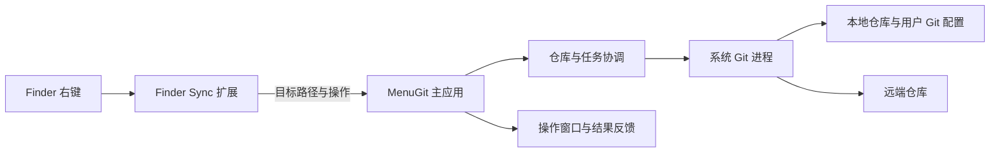

# MenuGit macOS 首版开发方案（待评审）

| 项目 | 内容 |
| --- | --- |
| 状态 | 方案草案；不表示开发、技术验证或验收已经完成 |
| 日期 | 2026-10-29 |
| 需求基线 | [macOS 需求规格](Requirements-Spec-MenuGit-macOS.md) |
| 产品概要 | [PRD](PRD-MenuGit.md) |
| 页面与流程 | [交互原型](prototype.html)，使用模拟数据 |
| 既有技术方向 | [原生 macOS 决策](adr/0001-native-macos-app.md) |

本文是供讨论和实施准备的方案，不覆盖需求规格。D-01～D-03 已确定，T 项验证结果可能改变部分实现；不把此文当成已通过的最终技术设计。

## 1. 目标与边界

首版仅面向 macOS，以 Finder 右键为主要入口，完成提交、推送、拉取、分支、日志、创建、克隆和冲突处理。提交成功后打开推送确认，但只有用户再次点击推送才执行。采用 SwiftUI / Swift 主应用、Finder Sync 扩展和系统 Git。支持 Apple Silicon 和 Intel 的 Universal 构建为目标，最低 macOS 版本与 Intel 实机矩阵待验证。

首版不包括行级暂存、stash 管理、交互式 rebase、强制推送、一键放弃修改或状态角标。拉取若按用户 Git 配置进入普通 rebase，需要提供相应冲突处理和续行，这与提供交互式 rebase 编辑界面不同。

## 2. 组件与职责

| 组件 | 职责 | 关键边界 |
| --- | --- | --- |
| Finder Sync 扩展 | 提供符合上下文的菜单，采集右键目标、所选文件和动作，尽快交给主应用。 | 不在菜单回调里执行耗时 Git 操作；目录覆盖、目标获取和主应用通信方式先实测。 |
| SwiftUI 主应用 | 管理提交、推送、拉取、分支、日志、初始化、克隆、冲突及设置等窗口。 | Finder 是主要入口；Dock 无上下文时提供最近仓库和打开仓库的兜底。 |
| 仓库与任务协调 | 定位仓库，维护操作上下文，检查状态，串行协调同仓库写操作，跟踪进行中操作和取消。 | 同一仓库的写操作不能互相覆盖；不能把应用内锁当作能控制其他 Git 客户端。 |
| Git 执行层 | 运行用户环境中的 Git，收集退出码、进度和错误，复用 Git 配置、凭证助手、SSH 与 hooks。 | 参数逐项传递，避免 shell 字符串拼接；路径、编码、环境及交互式提示都需验证。 |
| 冲突处理 | 从 Git 实际冲突状态构建文件、冲突块、结果和操作上下文；在允许的范围内保存、撤销、继续或中止。 | 展示的两侧要和实际 merge / rebase 状态对应；不安全或无法识别的冲突保留现场，不能误标记解决。 |

扩展与主应用的通信考虑系统支持的进程间通信和共享容器，但具体机制尚未确定。应先验证 Finder 扩展唤起主应用、传递多选和当前目录、主应用尚未运行、短时重复请求等场景，再选择机制；不要为了实现通信常驻执行 Git。

## 3. 关键设计

### 3.1 Finder 上下文和仓库发现

- 分别处理文件或目录右键、多个文件右键和文件夹空白区域右键。尽早捕获目标路径、选中项和菜单动作，避免用户操作 Finder 后上下文发生变化。
- 从目标路径向上识别最近的工作树；考虑嵌套仓库、`.git` 为文件的 worktree、符号链接以及路径被移动或删除的情况。目录创建仅在不属于现有工作树时提供。
- 产品目标是用户可访问的本地目录及挂载磁盘，保护性系统目录不纳入承诺。先验证实际可注册范围、扩展启用方式、安装后生效时机和跨进程文件访问，不能把注册监控目录当成读写授权。
- 扩展不可用或访问被系统拒绝时给出可操作的提示；最终兜底方式取决于 Finder 覆盖验证，不能预先承诺所有路径均可直接右键。

Apple 文档说明 Finder Sync 需要注册监控目录，且所选项目与目标 URL 只在特定菜单回调或动作中有效：[Finder Sync 指南](https://developer.apple.com/library/archive/documentation/General/Conceptual/ExtensibilityPG/Finder.html)、[selectedItemURLs](https://developer.apple.com/documentation/findersync/fifindersynccontroller/selecteditemurls%28%29)。

### 3.2 进程、状态与并发

- 后台启动 Git 进程，不阻塞 Finder 或主窗口；为每次操作记录仓库、操作类型和生命周期，展示可理解的进度、结果和失败原因。
- 使用适合机器读取的 Git 输出获取状态与路径，处理空格、换行、Unicode、重命名和删除；不要按人类可读文本或空格拆分路径。状态不以 Finder 缓存或原型模拟数据为准。
- 应用内按实际仓库身份协调写操作；Git 自身锁或外部客户端产生的状态变化需要识别并反馈。提交前、保存冲突结果前和继续操作前重新核实状态；若发生变化，停止并要求用户重新查看，不静默覆盖。
- Git 缺失、版本不兼容、路径不可访问、认证或 SSH 交互失败、hooks 失败和操作取消都要可恢复地反馈。不要在诊断输出中暴露凭证；原始输出展示和复制前需脱敏。

### 3.3 提交与暂存安全

- 状态和差异必须区分工作区与暂存区；用户只勾选文件时，提交不得混入未选文件的已暂存内容。界面应能解释最终要提交的内容，而不能仅依赖一次缓存的状态。
- D-01 已确认：选中文件提交工作区当前完整内容，提示包含未暂存修改；未选文件的已暂存内容不混入本次提交且必须保留。不能假定普通暂存再提交一定满足该规则。
- 对临时索引、路径限定提交或其他策略进行原型验证与失败注入，比较新增、删除、重命名、部分暂存、hooks、取消和外部并发修改；任何方案必须保证未选暂存内容不混入提交且不被丢失。hook 失败时展示结果并保留可恢复状态，不绕过 hook。
- 提交成功只创建本地提交，展示成功后进入推送确认；取消推送不撤销提交。

Git 文档说明，暂存区与工作区可以不同，按路径提交与普通提交的内容选择也不同：[git-commit](https://git-scm.com/docs/git-commit)、[git-status](https://git-scm.com/docs/git-status)。

### 3.4 拉取、推送、凭证和远端

- 当前分支有上游时使用既定上游；没有上游时，推送可选择远端目标或创建同名远端分支，拉取只选择已有来源。仅在用户选择记住目标或显式检出跟踪分支时更改当前仓库的跟踪关系。
- 无远端仓库时，在推送流程提供添加仅属于当前仓库的远端地址入口（D-02）；不引入完整 Git 配置页面。原型需更新。
- 远端拒绝推送时保留本地提交，提供拉取或稍后处理；认证、网络、权限等其他失败分别提示并允许合适的重试。基于实际结果更新状态，不仅根据旧的领先 / 落后缓存推断成功或失败。
- 尊重用户的 pull 策略及相关配置，不额外启用自动暂存。原型展示的是未启用自动暂存的示例，真实应用需测试用户已配置自动暂存时的行为和后续冲突。验证 GUI 进程是否能使用现有 credential helper、SSH agent、密钥口令与交互式认证；不自行存储凭证，不假定所有 helper 都能无交互运行。
- 克隆前确认目标，显示真实可获得的进度并允许取消；取消后处理部分目录时必须识别它是否由本次操作创建，不删除已有用户文件。完成后打开目标目录。

### 3.5 冲突处理与恢复

- 使用真实 Git 状态区分合并与变基，列出文件和文本冲突块，支持选择本地 / 传入 / 两边、手动编辑、长内容查看、逐块跳转、批量处理和最近操作撤销。
- 批量仅处理未解决冲突块时，保留已选择的块和冲突外内容；替换整份版本时提前显示范围和可能丢失的另一侧内容。二进制文件只能按整份版本处理。
- 手动结果保存前检查冲突状态并验证文件未被外部改动；冲突标记检查只是辅助，不能代替 Git 未合并状态检查和用户审阅。必须处理缺失一侧、删除 / 修改、重命名、二进制、编码和文件模式等复杂场景；不能安全识别时保留现场并提示可恢复的外部处理方式。支持范围和具体交互待 T-09 验证。
- 全部文件解决后，由用户明确继续；按当前 Git 操作调用对应续行并重新读取状态。变基可能在后续提交再次停止，须返回冲突处理，不提前显示全部成功。用户可中止并看到影响提示；合并开始前已有的未提交更改不保证总能由 Git 恢复。
- 应用关闭、崩溃、其他工具修改仓库或冲突窗口关闭后，应能重新从 Git 状态识别未完成操作；同次运行中关闭并重开冲突窗口应保留未保存的界面草稿；正常退出提醒先保存或放弃；意外退出未保存草稿可能丢失（D-03）。

参考：[git-merge](https://git-scm.com/docs/git-merge)、[git-rebase](https://git-scm.com/docs/git-rebase)。

### 3.6 分支、日志与性能

- 分支切换使用 Git 的结果判断是否安全；不自动暂存或丢弃。分支名冲突、非法名称、同名本地分支和已被其他工作树使用的情况应给出明确反馈。
- 日志默认展示当前分支，初次读取最近 200 条，后续按需加载；文件上下文只过滤相关文件。日志差异以所选提交及其父提交为依据，合并提交与无父提交的显示方式需测试并明确。
- 大文件差异、冲突块和长日志按需加载；阈值、响应时间和 100 个以上冲突的测试规模以测量后确定，不把模拟数据表现当作性能结论。

## 4. macOS 适配与分发验证

| 验证项 | 验证重点 | 结果用途 |
| --- | --- | --- |
| Finder 扩展 | 根目录、内部目录、单选 / 多选、空白处、非仓库、嵌套仓库和挂载磁盘；启用、重启 Finder、安装更新。 | 决定可兑现的右键覆盖范围与兜底。 |
| 文件与权限 | 应用和扩展访问项目目录、外接磁盘及系统保护目录时的权限差异；拒绝后的提示与恢复。 | 确定授权方式和安装指引。 |
| Git 与认证 | Git 路径及版本、GUI 进程环境、HTTPS helper、SSH agent、交互认证和 hooks。 | 确定兼容范围、错误处理和缺失 Git 指引。 |
| 架构与系统 | Apple Silicon 和 Intel 的构建与实机；最低系统版本和目标组合。 | 确认可发布的兼容矩阵。 |
| 分发 | Developer ID 签名、扩展嵌入、DMG、公证、首次启动及更新后的扩展状态。 | 形成安装、启用及发布验收流程。 |

Apple 官方资料：[Finder Sync](https://developer.apple.com/library/archive/documentation/General/Conceptual/ExtensibilityPG/Finder.html)、[macOS 外部分发](https://developer.apple.com/documentation/Xcode/distributing-your-app-for-beta-testing-and-releases)、[Universal 构建](https://developer.apple.com/documentation/apple-silicon/building-a-universal-macos-binary)。

## 5. 建议实施顺序

以下是评审后的建议顺序；此文档整理阶段不实施代码。

1. **风险验证：**先验证 Finder 可覆盖的位置、权限、扩展与主应用通信，以及 GUI 下系统 Git 和凭证的可用性；记录不支持的路径与替代方案。
2. **基础能力：**建立应用与扩展、仓库上下文和任务执行框架；完成初始化 / 克隆、状态和只读差异。不要以模拟结果替代真实仓库结果。
3. **提交和同步：**按 D-01、D-02 实现安全提交、推送确认、拉取与失败反馈；覆盖部分暂存和 hooks。
4. **冲突、分支、日志：**按首版要求实现冲突工作流、二进制和复杂冲突安全兜底、分支切换和日志浏览；验证 merge 和 rebase 的多次停止与恢复。
5. **macOS 验收与分发：**完成中英文、辅助功能、真实机器兼容、性能、签名、公证和 DMG；整理权限与启用说明。

## 6. 验收矩阵

- **Finder：**仓库内外、目录本身 / 内部空白、单选 / 多选、嵌套工作树、外接磁盘、未启用扩展以及无权限路径。记录不同 macOS 与设备组合的结果。
- **提交：**无变更、未选文件、空信息、文件级范围、新增 / 删除 / 重命名、已暂存与未暂存共存、未选暂存保留、hook 失败、外部并发修改；确认提交后尚未推送。
- **同步：**无上游、无远端、已有及新远端分支、拉取无更新、成功、推送拒绝、认证 / 网络失败和取消；验证 Git 配置及凭证实际生效。
- **冲突：**多个文件、长块、多块、批量按块与整文件、编辑 / 撤销、二进制和复杂类型、外部修改、关闭后返回、merge / rebase 继续与中止，以及多次冲突。
- **分支 / 日志 / 克隆：**重复分支、切换可能覆盖修改、分支与日志对应、文件历史、克隆目标已存在、取消与清理、完成后进入目录。
- **发布：**中英文、关键流程键盘可用、辅助功能人工检查、Apple Silicon / Intel、签名、公证、扩展启用和首次使用。

## 7. 当前阻塞决策与后续评审

- **D-01～D-03：**用户已确认完整文件提交、添加当前仓库远端，以及草稿退出处理；实现仍需验证安全性。
- **T-01～T-09：**以需求规格的待验证列表为准。Finder 覆盖、系统权限、Git 交互和冲突恢复不能仅靠 HTML 原型或本文判定。
- **辅助验证：**最低系统版本、诊断保留阈值、差异截断阈值、更新地址和复杂冲突兜底的具体形式仍待评审或测试。
